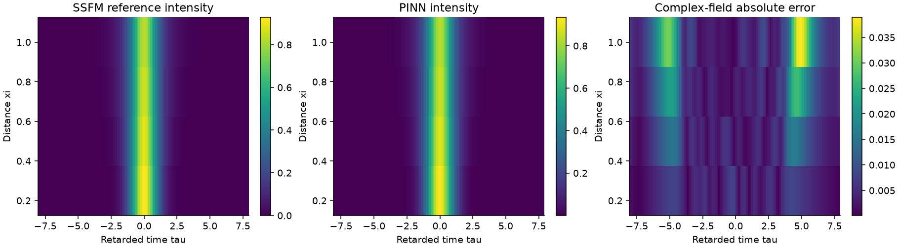
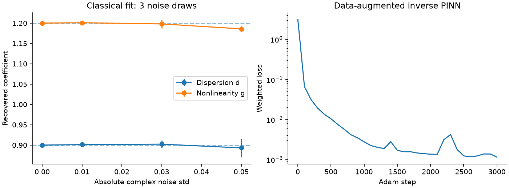

# Fiber parameter recovery with numerical fitting and a PINN

## Standalone repository quick start

This repository contains the complete source, executed notebooks, technical report, retained datasets, figures and project-specific tests. No other project folder is required.

```powershell
python -m venv .venv
.\.venv\Scripts\python.exe -m pip install -e ".[test,notebooks]"
.\.venv\Scripts\python.exe verify.py
.\.venv\Scripts\python.exe -m pytest -q
.\.venv\Scripts\python.exe reproduce.py --profile smoke --run-tag smoke-check
```

Use `.venv/bin/python` on Linux/macOS. Run `reproduce.py --profile standard --run-tag my-run` for the full investigation. The `research` profile is available but its results are not claimed. `run.py` is the baseline; `study.py` contains extensions.

Open `notebooks/` in VS Code and select this virtual environment. `report/technical_report.md` explains the methods and findings. `results/` contains the retained standard study, and `published/manifest.json` records its hashes. `verify.py` is read-only and does not retrain. Prior default results are archived before reproduction; tagged runs leave retained results unchanged.

All data are synthetic. The implementation and initial writing were developed with AI assistance. The cited scientific methods are established; algorithmic novelty is not claimed. `environment-tested.txt` records the full development environment, including optional tools; `pyproject.toml` lists this project's actual installation requirements.

This study estimates dispersion d and Kerr nonlinearity g from sparse, noisy complex-field samples generated by the NLSE. A conventional least-squares fit of the validated SSFM provides a baseline. A data-augmented inverse PINN estimates the field and coefficients jointly, with its actual accuracy and cost reported without a success threshold chosen after training.





## Measurement model

Use $iu_\xi+(d/2)u_{\tau\tau}+g|u|^2u=0$, with true (d,g)=(0.9,1.2). The known input is a chirped Gaussian $e^{-\tau^2/2+0.25i\tau^2}$. Complex samples are taken at four distances (0.25,0.5,0.75,1), at 32 time coordinates around the pulse, yielding 128 complex labels. Measurement phase is assumed available, as in coherent field characterization; this is not an intensity-only estimator.

Circular complex Gaussian noise has $E|\epsilon|^2=\sigma^2$, with independent real and imaginary standard deviations sigma/sqrt(2). Sigma is an absolute amplitude scale; peak input amplitude is one. Data generation uses 800 propagation steps per distance unit, while fitting uses 200, reducing but not eliminating shared-model bias. Both use 128 temporal samples and the same ideal NLSE; this remains a synthetic matched-model experiment.

## Conventional baseline

Bounded nonlinear least squares minimizes concatenated real and imaginary residuals, with d,g in [0.2,2]. The noise scan uses sigma=0,0.01,0.03,0.05 with three independent draws per level. Means and standard deviations are descriptive, not calibrated confidence intervals. The Jacobian condition number on the shared comparison dataset is a local sensitivity diagnostic; it does not prove global uniqueness.

## PINN and loss

The network has inputs (xi,tau), three hidden tanh layers of width 48, and outputs (a,b) representing u=a+ib. Trainable log coefficients enforce d,g>0. Coordinates are scaled inside the network; autograd differentiates with respect to the original coordinates so chain-rule factors are included.

$$r_R=-b_\xi+\frac d2a_{\tau\tau}+g(a^2+b^2)a,$$
$$r_I=a_\xi+\frac d2b_{\tau\tau}+g(a^2+b^2)b.$$

The objective is residual MSE + 20×complex-label MSE + 20×initial-condition MSE + boundary MSE. The finite-window boundary is approximately zero, not a periodic PINN constraint; it is appropriate only for localized fields. Each Adam step resamples 384 collocation points. Initial conditions use the full known input. Default training is 2500 steps at learning rate 0.002 on CPU, seed 7. This is a baseline, not evidence that a PINN is the best estimator.

## Reproduce and inspect

The upgraded study is `python reproduce.py --profile standard`. It runs three joint-inverse seeds, three data-only seeds and one physics-only forward ablation with true coefficients already known. All use 3000 Adam steps followed by 40 fixed-collocation L-BFGS outer steps. Validation uses four propagation distances absent from supervised labels; pulse-region and full-window errors are separate.

Read the [technical report](report/technical_report.md) and [three notebooks](notebooks/). `results/advanced_metrics.json` stores all runs and same-grid forward timings, `advanced_data.npz` stores the unseen-distance references, and mode/seed-named `.pt` files retain every model. Added figures are `unseen_distance_comparison.png` and `ablation.png`. The data-only model's coefficients are frozen rather than inferred.

From the repository root, run `python run.py --steps 2500`.

- `results/inference.png`: classical noise sensitivity and PINN loss history.
- `results/pinn_comparison.png`: reference intensity, learned intensity, and absolute complex-field error.
- `results/pinn.pt`: state dictionary, architecture width, step count and seed. Recreate with `make_pinn()` and load the state dictionary; use only trusted checkpoints.
- `results/study_data.npz`: clean reference, noisy labels, sample indices, and learned field.
- `results/metrics.json`: coefficient errors, field error on time samples disjoint from labels, coefficient trajectory, timings and Jacobian conditioning.

The held-out set excludes labeled temporal indices at each measured distance. It tests interpolation across time, not generalization to unseen propagation distances or different pulses. Dense inference time and classical optimization time measure different workloads, so their ratio is not a direct solver speedup. Both estimators receive the same noisy labels and known input for their main comparison.

## Limitations and next experiments

The baseline uses one training seed; the extended study evaluates three joint-inverse seeds, data-only learning and unseen propagation distances. All advanced seeds share one noisy measurement dataset, so their spread describes training variability rather than measurement uncertainty. Remaining investigations include collocation-density sensitivity, intensity-only observations and additional independent measurement datasets. A visually accurate field can still have biased coefficients, and training can stagnate or favour low-amplitude solutions.

The analytical-soliton and plane-wave residual tests verify derivative signs independently of training. A separate inverse test checks recovery using different propagation step resolutions.

## References

1. G. P. Agrawal, *Nonlinear Fiber Optics*, 6th ed., Academic Press (2019), Chapters 2–5. [Publisher](https://shop.elsevier.com/books/nonlinear-fiber-optics/agrawal/978-0-12-817042-7). Physical model, normalization and nonlinear pulse propagation.
2. M. Raissi, P. Perdikaris and G. E. Karniadakis, “Physics-informed neural networks: A deep learning framework for solving forward and inverse problems involving nonlinear partial differential equations,” *Journal of Computational Physics* **378**, 686–707 (2019). [DOI](https://doi.org/10.1016/j.jcp.2018.10.045). PINN methodology and forward/inverse formulations.
3. M. Raissi, P. Perdikaris and G. E. Karniadakis, *Physics Informed Deep Learning Part II: Data-driven Discovery of Nonlinear Partial Differential Equations* (2017). [Paper](https://arxiv.org/abs/1711.10566). Background on learning unknown PDE coefficients.
4. A. S. Krishnapriyan, A. Gholami, S. Zhe, R. M. Kirby and M. W. Mahoney, “Characterizing possible failure modes in physics-informed neural networks,” *Advances in Neural Information Processing Systems* **34** (2021). [Paper](https://arxiv.org/abs/2109.01050). Motivation for inspecting optimization failures and ablations; this project does not reproduce that paper's experiments.
5. SciPy developers, [least_squares documentation](https://docs.scipy.org/doc/scipy/reference/generated/scipy.optimize.least_squares.html). Implementation reference for the bounded nonlinear least-squares baseline.
